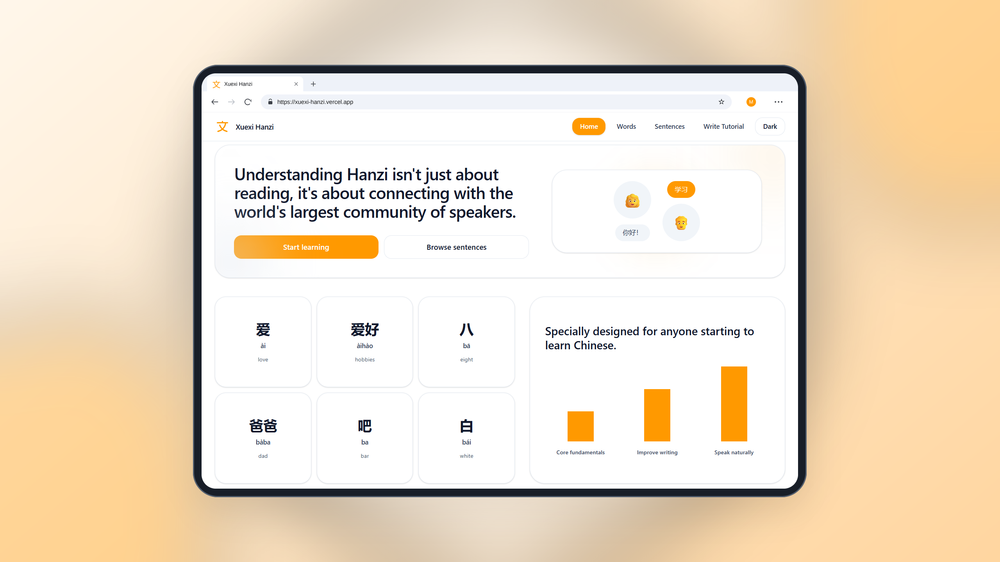

# Xuexi Hanzi · 学习汉字

Free online Chinese character (Hanzi) learning platform. Vocabulary, example sentences, and stroke-order writing practice, with HSK levels built in.

**Live site:** [https://xuexi-hanzi.vercel.app](https://xuexi-hanzi.vercel.app)

---

## Why I built this

Chinese is universally recognized as the #1 world's hardest language, and more than a billion people speak it. The difficulty is not grammar, which is refreshingly simple. The difficulty is the writing system. To read a newspaper comfortably you need roughly a thousand characters, and every one of them has to be recognised on sight, remembered, and written in the correct stroke order.

Most learners in Indonesia (and elsewhere) meet this wall with resources that are either expensive, locked behind an account, or built for a classroom rather than for one person on a phone at night. So this project starts at the part that people struggle with most: **Hanzi as the foundation**.

The goals are simple and permanent:

- **Free, forever, no login, no paywall.** Open the site and start learning.
- **Characters first.** Words, sentences, and writing practice all revolve around recognising and producing Hanzi.
- **Works on a phone**, because that is what most people actually have.
- **Type anything.** `爱`, `ai`, `ài`, and `love` all find the same entry. You should never need to know the tones or paste a character just to look something up.

Currently focused on HSK levels 1, 2, and 3. The whole site runs without a database server, so it can be hosted for free.

## Screenshot



<!-- More page captures can live in public/assets/ as words.png, sentences.png, and write-tutorial.png. -->

## Feature highlights

| Page | What it does |
| --- | --- |
| **`/words`** | Search 11,092 vocabulary entries by Hanzi, pinyin (with or without tones), or English meaning. Filter by HSK level, 12 cards per page, tap any card to hear it pronounced. |
| **`/sentences`** | The same entries read as full example sentences with pinyin and translation, browsable across 17 everyday themes (Family, Food, Emotion, Transport, and more). |
| **`/write-tutorial`** | Stroke-order practice for 1,512 single characters. **Animate** demonstrates the correct order; **Quiz** waits for each stroke you draw and reveals a hint after the first miss. |

Cross-cutting:

- **Tone-insensitive search.** `ai` matches `ài`, `nǐ hǎo` matches `你好`. Queries are folded onto the same normalised form that the dataset is built with.
- **Audio without an audio file.** Pronunciation uses the browser's own speech synthesis (`zh-CN`, slightly slowed to 0.92 rate), so nothing is downloaded or streamed and it costs nothing to host.
- **Every state lives in the URL.** A search is just `?q=ai&level=beginner&page=2`, so results are bookmarkable, shareable, and the back button behaves.
- **Dark mode toggle**, responsive layout, breadcrumbs on every page.
- **No accounts, no cookies banner, no tracking.**

## Architecture

There is **no database and no environment variable** anywhere in this project. The data is compiled into the build.

```
database/full-HSK.csv                    source of truth (semicolon-delimited, committed)
        │
        │  npm run data:build            scripts/build-dataset.ts
        ▼
app/data/hanzi-dataset.json             11,092 rows, generated and committed
        │
        │  import                        app/lib/hanzi-data.ts   ← "server-only" boundary
        ▼
in-memory array (typed HanziRow[])
        │
        │  filter → score → sort → slice  app/lib/search.ts
        ▼
server components (app/page.tsx, /words, /sentences)
        │
        ▼
client components only where the browser is needed
        (WordCard / SentenceCard speech, ThemeToggle, WriteTutorialClient strokes)
```

Key properties:

- **The dataset never reaches the browser.** `app/lib/hanzi-data.ts` imports `server-only`, so if any client component tried to import it the build would fail loudly. In production the browser downloads about 638 KB of JavaScript; the ~4.8 MB dataset stays on the server.
- **Search is a plain array scan.** Filtering, relevance scoring, and pagination are `Array.filter` / `sort` / `slice` over an array that is loaded once per server process. Eleven thousand rows is small enough that this is faster than a network round-trip to a database.
- **Relevance is ordered, not fuzzy.** Exact character match ranks above exact toneless-pinyin match, above prefix, above substring, above English meaning; ties break on `sourceId` so results are deterministic and pagination is stable.
- **Static where possible.** `/` and `/write-tutorial` are prerendered at build time; `/words` and `/sentences` render on demand because they depend on the query string.
- **One known quirk:** `/write-tutorial` reads `database/full-HSK.csv` directly with `fs` during its prerender (it needs single-character rows only), so the CSV file and the `csv-parse` devDependency must be present at build time.

### Deployment

Pushing to `main` on [github.com/mnasruloh/hanzi-web](https://github.com/mnasruloh/hanzi-web) triggers an automatic Vercel build and production promotion. No environment variables, no database provisioning, no postinstall codegen step.

## Data model

One row = one vocabulary item **plus** its example sentence. The table is deliberately denormalised: there are no joins and no second table, because every entry already carries the sentence that illustrates it.

CSV header (`;`-delimited, 11 columns):

```
ID;Level;Word;Pinyin;Normalized;Meaning;Sentence;Sentence_Pinyin;Sentence_Normalized;Sentence_Meaning;Category
```

Generated JSON row:

```json
{
  "id": 1,
  "sourceId": "L1-0001",
  "level": 1,
  "simplified": "爱",
  "pinyin": "ài",
  "pinyinNormalized": "ai",
  "meaning": "love",
  "sentence": "我爱我的家人。",
  "sentencePinyin": "wǒ ài wǒ de jiā rén 。",
  "sentencePinyinNormalized": "woaiwodejiaren",
  "sentenceNormalized": "wo ai wo de jia ren 。",
  "sentenceMeaning": "i love my family.",
  "category": "Emotion"
}
```

| Field | Origin | Purpose |
| --- | --- | --- |
| `id` | assigned at build, 1-based | React list keys |
| `sourceId` | CSV `ID` | stable external identity, unique, defines the default sort order |
| `level` | CSV `Level` mapped `Beginner→1`, `Intermediate→2`, `Advanced→3` | HSK level filter |
| `simplified` | CSV `Word` | the character or word being learned |
| `pinyin` | CSV `Pinyin` | display with tone marks |
| `pinyinNormalized` | CSV `Normalized`, else computed | toneless match key for the word |
| `meaning` | CSV `Meaning` | English gloss |
| `sentence` / `sentencePinyin` / `sentenceMeaning` | CSV columns of the same name | example sentence and its readings |
| `sentencePinyinNormalized` | always computed from `sentencePinyin` | toneless, spaceless match key for the sentence |
| `sentenceNormalized` | CSV `Sentence_Normalized` | toneless but spaced reading |
| `category` | CSV `Category` | sentence theme filter |

`normalizePinyin()` is what makes tone-insensitive search work: Unicode decomposition, strip the diacritic marks, fold `ü`/`u:` to `v`, drop punctuation, remove all spaces, lowercase. Both the stored `*Normalized` fields and the incoming query go through it, so they meet in the same form.

Dataset contents at a glance:

| Measure | Value |
| --- | --- |
| Total entries | 11,092 |
| Unique headwords | 10,959 |
| **Distinct Hanzi characters** | **2,976** |
| Multi-character words/phrases | 9,461 |
| HSK 1 (beginner) | 2,245 |
| HSK 2 (intermediate) | 3,211 |
| HSK 3 (advanced) | 5,636 |
| Sentence categories | 17 |
| Single characters available for writing practice | 1,512 |

Categories: Activity, Appearance, Communication, Daily, Emotion, Family, Health, Number, Office, People, Place, School, Shopping, Time, Transport, Weather.

## Tech stack

| Layer | Choice |
| --- | --- |
| Framework | Next.js **16.2.4** (App Router, Turbopack) |
| UI | React **19.2.4**, TypeScript **5** |
| Styling | Tailwind CSS **v4** via `@tailwindcss/postcss` |
| Writing practice | [hanzi-writer](https://hanziwriter.org) **3.7.3**, stroke data fetched from the `hanzi-writer-data` CDN |
| Data pipeline | `csv-parse` **5.5.6** + `tsx` (dev only), `server-only` **0.0.1** in production deps |
| Audio | Web Speech API (`SpeechSynthesis`), no dependency |
| Quality | ESLint **9** with `eslint-config-next` |
| Hosting | Vercel, Git-connected, auto-deploy on `main` |

## Getting started

Requires **Node.js 20 or newer**. No MySQL, no Laragon, no database, no `.env` file.

```bash
npm install
npm run dev
```

Open [http://localhost:3000](http://localhost:3000).

The dataset is committed, so the site works immediately after `npm install`. There is nothing to migrate or seed.

| Script | Command |
| --- | --- |
| `npm run dev` | Development server with hot reload |
| `npm run build` | Production build |
| `npm run start` | Serve the production build |
| `npm run lint` | ESLint |
| `npm run data:build` | Regenerate `app/data/hanzi-dataset.json` from the CSV |

### Updating the vocabulary

1. Edit `database/full-HSK.csv` (keep the `;` delimiter and the 11 column names).
2. `npm run data:build`. It prints the row count and per-level totals, and refuses to run if a `sourceId` is duplicated or a required column is empty.
3. Commit both the CSV and the regenerated JSON, then push.

## Project layout

```
app/
  page.tsx                 home / landing
  words/page.tsx           vocabulary search
  sentences/page.tsx       sentence search
  write-tutorial/          stroke-order practice (server page + client canvas)
  components/              cards, filter bars, pagination, navbar, theme toggle
  hooks/useHanziSpeech.ts  browser speech synthesis
  lib/
    hanzi-data.ts          loads the dataset, server-only guard
    search.ts              filtering, relevance ranking, pagination
    normalize.ts           pinyin folding
  data/hanzi-dataset.json  generated, committed
scripts/build-dataset.ts   CSV → JSON
database/full-HSK.csv      source data
```
